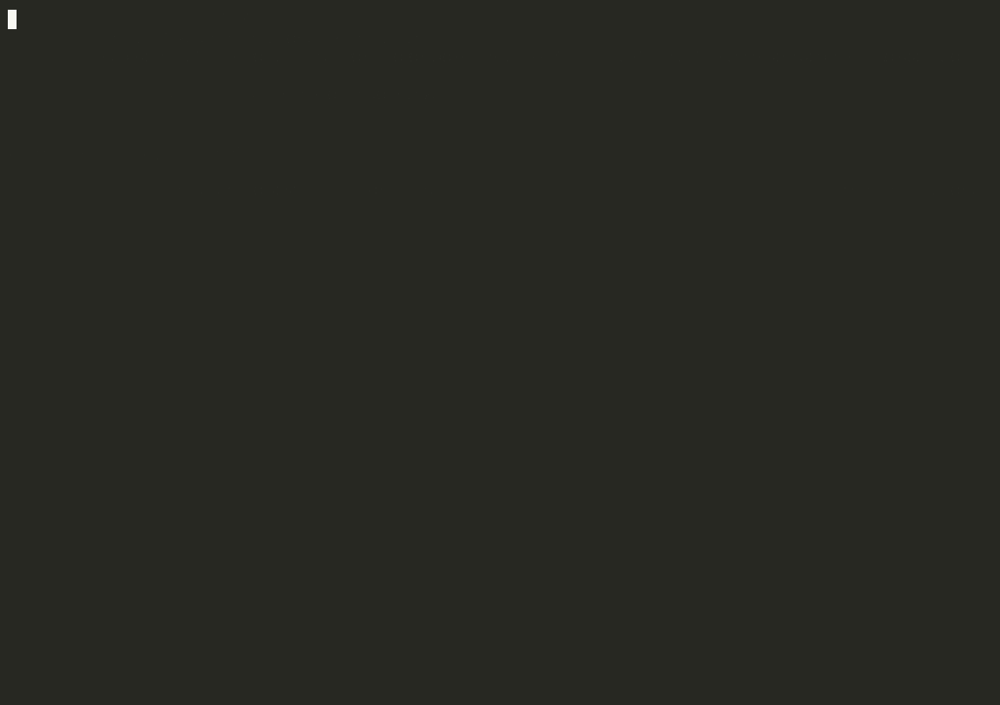

# Nori-Rel

Predict from relational databases with [Nori](https://docs.synthefy.com/nori).
Nori-Rel reads a bounded database snapshot, constructs historical targets and
FastDFS features, and runs local or hosted inference through one Python client.

The supported package covers PostgreSQL, MySQL 8, Snowflake standard tables,
and Databricks Unity Catalog Delta tables. Releases come from reviewed commits
on `main`.

Review the [support contract](docs/support.md) and
[dependency security assessment](docs/dependency-security.md) before deployment.
The assessment includes scoped, expiring exceptions for upstream dependencies.

## Install

Python 3.11, 3.12 and 3.13 are supported. Install your connector and, for the default
local inference mode, the model runtime:

```bash
python -m pip install "nori-rel[database,local]"
# Other connectors:
python -m pip install "nori-rel[mysql,local]"
python -m pip install "nori-rel[snowflake,local]"
python -m pip install "nori-rel[databricks,local]"
```

For hosted inference, omit `local` and set `SYNTHEFY_NORI_API_KEY` privately.
A hosted installation does not require the local model runtime or model weights.
See [supported capabilities](docs/support.md) for platform and target limits.

## Try it in Colab

[](https://colab.research.google.com/github/Synthefy/nori-rel/blob/main/colab/nori_rel_quickstart.ipynb)

The [quickstart notebook](colab/nori_rel_quickstart.ipynb) runs Nori-Rel on
your own Snowflake, PostgreSQL (including AWS RDS or Aurora) or Databricks
tables. Fill in the connection and the query, keep credentials in Colab
Secrets, and run the cells: it checks your tables' keys and time columns,
predicts, checks the forecast on a window whose outcome is known, and saves a
pipeline you can replay.
A [worked example](colab/nori_rel_quickstart_example.ipynb) shows every output
of the same notebook run on the public RelBench `rel-f1` Formula 1 database.

## Work with an AI agent

The [`skills/`](skills/README.md) folder holds skills for Claude Code, Codex
and other agents that read the Agent Skills format. They take an agent through
a Nori-Rel project step by step and stop wherever a decision is yours:

| Skill | What the agent does |
|---|---|
| `quickstart` | Runs the whole path below in order. |
| `setup` | Installs the right extras, picks local or hosted Nori, verifies the environment. |
| `prepare-data` | Turns CSV, Excel, Parquet or JSON files into a PostgreSQL schema Nori-Rel can predict from, after you confirm every table and relationship. |
| `connect` | Connects PostgreSQL, MySQL, Snowflake or Databricks with a read-only identity and checks keys, links and time columns. |
| `predict` | Turns your question into PQL, sets the dates, runs the prediction. |
| `backtest` | Predicts from earlier dates whose outcome is known and compares Nori with simple references. |
| `features` | Chooses FastDFS, NoriDFS or the agent search, and explains what the features are. |
| `schedule` | Saves the pipeline and sets up a scheduled refresh from fresh rows. |

In Claude Code, install them as a plugin from this repository:

```text
/plugin marketplace add Synthefy/nori-rel
/plugin install nori-rel@synthefy-nori-rel
```

Then ask in your own words. This session opens with "I just installed the
plugin and I have never used Nori-Rel. How do I use this?" The agent loads
the quickstart, explains the six steps, asks what to predict, where the data
is and through what date it is complete, proposes the query and waits for a
yes, then runs the check, the prediction and a backtest, and ends with the
report and a weekly refresh job (Claude Opus 5.5, Nori 1.5 on CPU; the
waits are shortened):



Or copy the folders, with a `nori-rel-` prefix on each, into
`~/.claude/skills/` (Claude Code) or `~/.codex/skills/` (Codex). With another
agent, give it a `SKILL.md` as its instructions. The skills' scripts read credentials from environment variables
or AWS Secrets Manager and write no secret anywhere.

## Predict customer spend

This example expects existing `users(user_id, created_at)` and
`orders(order_id, user_id, event_time, amount)` tables with declared primary and
foreign keys. Set `DATABASE_URL` to a TLS-enabled PostgreSQL connection string.
Use [the synthetic example](examples/README.md) for a complete disposable dataset.

```python
from datetime import UTC, datetime

from nori_rel import EnvironmentCredential, NoriRelClient

with NoriRelClient() as client:
    source = client.connect(
        engine="postgresql",
        credential=EnvironmentCredential(variable="DATABASE_URL"),
        tables=["users", "orders"],
        time_columns={"orders": "event_time"},
    )
    details = client.predict(
        source=source,
        query="PREDICT SUM(orders.amount,0,30,days) FOR EACH users.user_id",
        anchor_times=[datetime(2026, 1, 1, tzinfo=UTC)],
        anchor_time=datetime(2026, 3, 1, tzinfo=UTC),
        observed_through=datetime(2026, 3, 1, tzinfo=UTC),
        entity_created_at="created_at",
        return_details=True,
    )
    predictions = details.predictions
    print(predictions[["entity_id", "prediction"]])
```

The query predicts each user's total order amount over the next 30 days.
`anchor_times` supplies historical examples; `anchor_time` is the scoring time.
`observed_through` is your verified data-completeness watermark, not an estimate
of completeness from the latest event. Use dates appropriate to your data and
at least 32 usable historical rows. Register every event table's timestamp;
other entity attributes must be immutable or valid at every requested anchor.

`entity_created_at` names a date or timestamp column on the entity table
(`users.created_at` here) that holds when each user first existed. A user gets
no training row for anchors before it and is not scored if created after
`anchor_time`; a null drops the user. Nori-Rel does not create this column. If
your table has none, add one, usually each entity's first event time. See
[PQL and time semantics](docs/pql.md) for this column, rates written as
`COUNT(...)/COUNT(...)`, and the v0 limits, with worked examples.

`max_context_rows` caps candidates before unknown labels are dropped, so a
rare or delayed label can leave few rows. `context=ContextPolicy(...)` instead
chooses among labelled rows only, and can balance a 0/1 label, spread rows
over cutoffs, cap rows per entity and map balanced probabilities back to the
population rate. `metadata["context_policy"]` reports the rows kept at each
cutoff either way. See [`docs/context-policy.md`](docs/context-policy.md).

No dates? A static target predicts a column of the entity table, learned from
the rows where it is known, for the rows where it is NULL. No time arguments
are needed:

```python
predictions = client.predict(
    source=source,
    query="PREDICT users.income FOR EACH users.user_id",
)
```

See [Static targets](docs/pql.md#static-targets) for how context and scoring
rows are chosen and how the target is kept out of the features.

The default mode runs Nori in your process. Both modes default to Nori 1.5
(`model="nori-1-5"`); pass `model="nori-30m"` for the previous default. The
first local prediction downloads model weights; subsequent predictions can use the populated cache offline.
Use `NoriRelClient(mode="hosted")` to send the generated context/query feature
matrices and labels to hosted Nori. Database connections, credentials, and raw
source tables stay in the caller's process. Generated features can still contain
sensitive information derived from those tables.

## Choose a feature search

Each prediction chooses its feature search with
`predict(..., feature_strategy=...)`: `"fastdfs"` (the default), `"noridfs"`, or
an `AgenticSearch`. `feature_strategy="noridfs"` plans a NoriDFS relationship
search over the foreign-key graph, with aggregation windows scaled to the
target's label interval. It needs only the core dependencies.

```python
details = client.predict(..., feature_strategy="noridfs")
```

`start_predict` takes `feature_strategy` too. `NoriRelClient(features=...)` is
deprecated: it still sets the search for predictions that pass none, with a
`DeprecationWarning`, and will be removed in 0.5.0.

`AgenticSearch` lets a language-model agent write SQL feature columns on top of
NoriDFS. Install `nori-rel[agentic]`. Each candidate program runs locally in an
in-memory DuckDB catalog and is scored with the client's own Nori predictor on
held-out historical rows. A program is kept only if it also beats NoriDFS alone
on a separate confirmation slice; otherwise the prediction uses NoriDFS alone.

```python
from nori_rel import AgenticSearch

search = AgenticSearch.claude()  # reads ANTHROPIC_API_KEY
details = client.predict(..., feature_strategy=search)
```

Because the choice is per prediction, one client and one source can compare
NoriDFS alone with an agent search, or agents on two models:

```python
opus = AgenticSearch.claude(model="claude-opus-5-5")
sonnet = AgenticSearch.claude(model="claude-sonnet-5-5")
for strategy in ("noridfs", opus, sonnet):
    details = client.predict(..., feature_strategy=strategy)
```

`AgenticSearch.openai(model=...)` uses an OpenAI-compatible endpoint. The agent
sends that model provider:

- your schema: table and column names, row counts, keys, and time columns;
- a profile of each column it asks about: the share of missing values, the
  number of distinct values, and either the 1st, 25th, 50th, 75th and 99th
  percentiles of a numeric column, the earliest and latest value of a date
  column, or the 10 most frequent values of any other column with their counts.
  Those values are raw cells, such as names, emails, or IDs;
- up to 50 rows of each exploratory query result;
- the error message of any query that fails, which can quote values.

Do not enable it for data that must not leave your environment for that
provider. A search also costs provider
tokens and extra Nori calls. Bound it with `max_cost_usd` (which also needs
`prices`) or the search's `limits`. It is not exercised against a live model provider in release certification. See
[run control](docs/run-control.md) for `stop` and `steer`.

The agent keeps a program only if it lowers the error on held-out history.
`predict(..., metric=...)` chooses that error for a regression target:

| `metric` | Error (lower is better) |
|---|---|
| `"mae"` (default) | Mean absolute error |
| `"mse"` | Mean squared error |
| `"rmse"` | Root mean squared error |
| `"nmae"` | MAE divided by the range (max minus min) of the actuals |
| `"nrmse"` | RMSE divided by the range of the actuals |
| `"medae"` | Median absolute error |
| `"wape"` | Total absolute error divided by total actual |
| `"mape"` | Mean absolute percentage error, over rows whose actual is not zero |
| `"smape"` | Symmetric MAPE: mean of 2\|error\| / (\|actual\| + \|forecast\|) |

On one holdout, NMAE and WAPE rank programs as MAE does and NRMSE as RMSE
does: each divides by the same constant for every candidate. MSE and RMSE
weigh large misses more. MAPE and SMAPE weigh every row equally in relative
terms, so small series count as much as large ones. The metric changes which
program is kept, not how the forecast is made. Trial and baseline events report
it, with relative and normalized errors as percentages
(`Trial 3/24: WAPE 11.20% ...`).

```python
client.predict(source=source, query=query, feature_strategy=search, metric="wape", ...)
```

`predict(agent_instructions="...")` sends your own text, verbatim, at the end
of the agent's request, for example "Signups on 1-3 Jun had broken tracking;
do not build features from them". It needs an `AgenticSearch` as the
prediction's feature search; with FastDFS, NoriDFS or a replayed program
`predict` raises instead of dropping the text. It cannot loosen the leak checks
or the scoring rules, which code enforces. `metadata["context_policy"]` records
the text and the agent stages that received it. It replaces
`AgenticSearch(task_hint=...)`, which still works with a `FutureWarning`;
passing both raises.

## Inspect the features

With `return_details=True`, `details.features` is the feature matrix Nori scored:
a pandas DataFrame with one row per `entity_id` and one column per feature.
Each column name says what the feature reads: the tables it goes through from
the entity, then the column, then the aggregate, joined with dots.

```python
print(details.features.head())
```

With the tables above, `orders.amount.mean` is the mean of `orders.amount`
over the user's orders and `orders.count` counts them; NoriDFS adds windows,
such as `orders.amount.mean_30d` for the last 30 days. A feature two links
away names both tables: with a `products` table that orders point to,
`orders.products.count` counts the products reached through the user's
orders. `users.created_at` is the user's own column, `anchor.cutoff_month` a
field of the anchor time, and an agent's column is `<query>.<column>`. When
two features would share a name, the table reached through a different
foreign key shows that key, as in `orders[buyer_id].count`.

`details.get_feature_table()` returns one row per column of `details.features`,
in the same order: its `feature` name, the `internal_name` the model, pipeline
and feature hash use, its `source`, the `sql` that computed it, its `dtype`,
and its `missing_share`, `mean`, `min` and `max` over the scored entities.
`sql` is the agent's query for an agent column and the statements FastDFS ran
for a FastDFS column; NoriDFS computes its features in pandas, so its `sql` is
`None`.

```python
table = details.get_feature_table()
print(table[["feature", "source", "missing_share", "mean"]])
print(table.set_index("feature").loc["orders.count", "sql"])
```

`details.metadata["features"]` is different: it names the feature search that
ran (`"fastdfs"`, `"noridfs"`, `"agentic"` or `"saved_program"`), not the matrix.

## Save and reload

Request prediction details to obtain a pipeline, then reconnect when using it:

```python
from nori_rel import NoriRelPipeline

if details.pipeline is None:
    raise RuntimeError("This prediction cannot be exported as a pipeline")
details.pipeline.save("customer_spend.json")

pipeline = NoriRelPipeline.load("customer_spend.json")
with NoriRelClient() as client:
    source = client.connect(
        engine="postgresql",
        credential=EnvironmentCredential(variable="DATABASE_URL"),
        tables=["users", "orders"],
        time_columns={"orders": "event_time"},
    )
    predictions = client.predict(
        source=source,
        pipeline=pipeline,
        as_of=datetime(2026, 4, 1, tzinfo=UTC),
        observed_through=datetime(2026, 4, 1, tzinfo=UTC),
    )
```

A pipeline stores the task, feature recipe (a FastDFS or NoriDFS plan, plus the
agent's SQL program after an agent search), schema contract, context policy, and
model settings. Each replay reads fresh rows. It contains no credentials,
source rows, or model weights. See [pipeline export](docs/pipeline-export.md)
and the runnable [save/reload example](examples/pipeline_reload.py).

## Operations and safety boundaries

Use the client as a context manager to close connection pools. PostgreSQL and
MySQL use TLS for remote hosts and read-only transactions; warehouse connectors
use pinned reads and require a dedicated identity without write privileges.
Warehouse capabilities and snapshot guarantees are documented in the
[connector guide](docs/warehouse-connectors.md). The [MySQL guide](docs/mysql.md)
covers RDS and Aurora MySQL, TLS modes, SSH tunnels, IAM database
authentication and type mapping.

`RelationalLimits` bounds tables, rows, snapshot memory, feature size, and SQL
statement time. Exceeding an extraction limit raises an error. These limits do
not cap total warehouse billing or the process's total memory. See
[configuration and errors](docs/api.md) and [progress/cancellation](docs/run-control.md).

## Development and licensing

See the [public API inventory](docs/public-api.md),
[CONTRIBUTING.md](CONTRIBUTING.md), [SECURITY.md](SECURITY.md), and
[RELEASING.md](RELEASING.md). Public release changes are recorded in
[CHANGELOG.md](CHANGELOG.md).

Original Synthefy code is [MIT-licensed](LICENSE). The vendored PQL grammar and
derived parser retain Apache-2.0 licensing. Dependencies, downloaded model weights,
and external datasets have their own terms; see [ATTRIBUTION.md](ATTRIBUTION.md).
